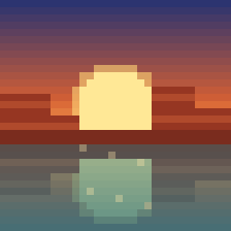

# Redrock Visuals



A western shader pack for **Minecraft Java 1.21.1** (Iris). Redrock Visuals paints the world in the colors of the Old
West: a golden sun, burning orange sunsets, dusty haze rolling over the ground, scattered desert clouds and rivers that
keep their vanilla color but move, refract and reflect like real water.

It was made for the [Wild West Universe](https://github.com/RaulDevStack/wild-west-universe) modpack, but it works in
any 1.21.1 world. It is built to be **balanced**: it looks good on a GTX 1050/1650-class graphics card and scales up
to high-end PCs with real voxel reflections.

> Redrock Visuals is open source under the [MIT License](LICENSE). Ready-to-use downloads are in the
> [Releases](https://github.com/RaulDevStack/redrock-visuals/releases).

## Requirements

| | |
|---|---|
| Redrock Visuals file | `redrock-visuals-1.0.0_1.21.1.zip` |
| Minecraft | Java Edition 1.21.1 |
| [Iris Shaders](https://modrinth.com/mod/iris) | for 1.21.1 (1.8 or newer recommended), with [Sodium](https://modrinth.com/mod/sodium) |
| Graphics | OpenGL 3.3 (OpenGL 4.2 for *Real Reflections*) |

Both the Fabric and the NeoForge versions of Iris work. OptiFine is not supported.

## Installation

1. Install Iris (and Sodium) for Minecraft 1.21.1.
2. Download the `.zip` from the [releases](https://github.com/RaulDevStack/redrock-visuals/releases).
3. Put the `.zip` **as it is (do not unzip it)** in the `shaderpacks` folder of your Minecraft installation.
4. In game: *Options → Video Settings → Shader Packs*, select **Redrock Visuals** and click *Apply*.
5. Choose a profile (see below) under *Shader Pack Settings*.

## Profiles

The profile selector sits at the top of *Shader Pack Settings*. The default is **Medium**.

| Profile | Meant for | Shadows | Fog & clouds | Water reflections |
|---|---|---|---|---|
| **Low** | Integrated graphics | 1024 px, 64 blocks, hard | Quarter resolution, fewer steps | Sky only |
| **Medium** | GTX 1050 / 1650 | 1536 px, 96 blocks, soft | Half resolution | Screen space |
| **High** | RTX 2060 / 3060 | 2048 px, 128 blocks, very soft | Half resolution, more steps | Screen space |
| **Ultra** | High-end PCs | 3072 px, 160 blocks, very soft | Full resolution | **Real (voxel ray traced)** |

## Features

### Light and color
- **Warm western lighting**: a golden midday sun, orange sunrises and sunsets, a pale dusty horizon, a soft blue
  moonlight and warm torchlight.
- **Shadows** with soft filtering, plus **cloud shadows** drifting over the ground.
- Plants and leaves let light through, so foliage never looks flat or black.
- **Emissive blocks**: torches, lanterns, glowstone, lava, fire, froglights and more glow.
- **Handheld light**: holding a torch or another light source lights up your surroundings.
- Exposure adapts to caves and to the night, ACES tonemapping, a light bloom and a subtle **western color grade**
  (adjustable, or off).

### Atmosphere
- **Volumetric fog**: a ground-level dust haze with **light shafts** between trees, buildings and mesas. It thickens
  into a mist at sunrise and when it rains, and the dust drifts with the wind.
- **Volumetric clouds**: scattered desert cumulus clouds with silver linings and soft shading. They move with the wind
  and cover the sky when it rains.
- A procedural sky with a real sun disk, sunset glow, moon halo and stars.
- **Border fog** that hides the edge of the render distance.
- Underwater, in lava and in powder snow, a fog matching the medium; blindness and darkness are respected.

### Water
- **Vanilla color kept**: the color comes from the vanilla water texture and each biome's water tint, so swamps, warm
  rivers and cold lakes keep their own color.
- **Real waves**: the water surface moves up and down, never above its vanilla height, so it never clips into blocks.
- **Refraction**: the riverbed wobbles under the waves.
- **Depth**: shallow water is clear and deep water gets darker and richer in the same color.
- **Reflections** with physically based Fresnel: weak when looking straight down, mirror-like at grazing angles. The
  sky is always reflected; terrain is reflected in screen space (Medium and High) or with real voxel reflections (Ultra).
- A soft **sun glint**, which turns into a path of light on the water at sunset.
- **Underwater view**: total internal reflection when looking up at the surface.

### Real reflections (Ultra)
The terrain around you (256 × 128 × 256 blocks) is stored in a 3D voxel grid, and every water pixel casts a real ray
through it. Water therefore reflects what is behind you, off screen or hidden behind other objects. Where the reflected
point is also visible on screen, the full-detail image is used; elsewhere each block is drawn with its average color,
lit by the sun, its shadow and the sky. Glowing blocks glow in reflections too.

- Only full cube blocks are reflected (fences, torches and plants are skipped; slabs and stairs appear as full blocks).
- It uses about 32 MB of video memory, only while it is on.
- It needs shadows to be on and a version of Iris with custom image support. Otherwise the pack falls back to screen
  space reflections automatically.

### Movement
- **Waving plants**: grass, flowers, ferns, crops, saplings, tall plants, seagrass and kelp.
- **Waving leaves** and vines, which move gently.
- **Waving water** and **waving lava**, which moves slowly and thickly.
- Wind gusts come and go, and everything moves more in the rain. Shadows move with the plants.

### Nether and End
Simple lighting and a fog that matches each dimension, with no shadows, clouds or volumetric fog, to save
performance.

## Settings

Everything can be changed in *Shader Pack Settings*. Values in **bold** are the defaults (Medium profile).

### Shadows
| Option | Values | What it does |
|---|---|---|
| Shadows | **On** / Off | Sun and moon shadows. Turning them off saves the most performance (it also turns off light shafts and real reflections). |
| Shadow Softness | Hard / **Soft** / Very Soft | Shadow edge filtering (1, 4 or 8 samples). |
| Shadow Resolution | 512 – 4096 (**1536**) | Shadow map size. |
| Shadow Distance | 48 – 192 (**96**) | How far shadows are drawn, in blocks. |
| Sun Angle | -40 – 40 (**-25**) | Tilts the sun's path so shadows are never straight down. |
| Cloud Shadows | **On** / Off | Clouds cast moving shadows on the ground. |

### Lighting
| Option | Default | What it does |
|---|---|---|
| Sun Intensity / Moon Intensity | **1.0** | Strength of sunlight and moonlight. |
| Ambient Light | **1.0** | Light coming from the sky. |
| Torch Light | **1.0** | Strength of block light (torches, lanterns…). |
| Minimum Light (caves) | **1.0** | Light in complete darkness. |
| Emissive Blocks | **1.0** | How much glowing blocks glow. |
| Handheld Light | **On** | Light from the light source in your hand. |

### Fog & Atmosphere
| Option | Default | What it does |
|---|---|---|
| Volumetric Fog | **On** | Dust haze with light shafts. |
| Light Shaft Intensity | **1.0** | Brightness of the light shafts. |
| Fog Quality | **8** steps | More steps give smoother fog (4 – 24). |
| Fog & Cloud Resolution | **0.5** | Resolution of fog and clouds: 0.25 is much faster, 1.0 is full resolution. |
| Fog Density | **1.0** | Overall amount of fog. |
| Fog Height | **66** | Height of the ground fog layer. |
| Fog Height Falloff | **28** | How fast the fog fades going up. |
| Morning Mist | **On** | Thicker fog at sunrise. |
| Drifting Dust | **On** | Moving dust inside the fog. |
| Border Fog | **On** | Hides the end of the render distance. |

### Clouds
| Option | Default | What it does |
|---|---|---|
| Volumetric Clouds | **On** | 3D clouds (vanilla clouds are always hidden). |
| Cloud Quality | **10** steps | Ray marching steps (6 – 32). |
| Cloud Lighting Quality | **2** | Light samples per step (1 – 4). |
| Cloud Height / Thickness | **210** / **90** | Altitude and thickness of the cloud layer. |
| Cloud Coverage | **0.40** | Amount of sky covered (rain always adds more). |
| Cloud Density | **1.0** | How solid the clouds look. |
| Cloud Speed | **1.0** | Wind speed of the clouds. |
| Cloud Distance | **2500** | How far clouds are drawn. |

### Water
| Option | Default | What it does |
|---|---|---|
| Real Reflections (voxels) | **Off** (on in Ultra) | Ray traced reflections that include what is off screen. |
| Real Reflection Range | **96** | Voxels crossed by each ray (48 – 256). |
| Screen Space Reflections | **On** | Terrain reflections from the image on screen. |
| Reflection Quality | **12** | Screen space reflection steps (8 – 32). |
| Water Opacity | **0.65** | How much of the vanilla water color covers the riverbed. |
| Water Murkiness | **0.10** | How fast water darkens with depth. |
| Wave Strength / Wave Speed | **1.0** | Size and speed of the small ripples on the surface. |
| Refraction | **1.0** | How much the riverbed wobbles. |

### Waving
| Option | Default | What it does |
|---|---|---|
| Waving Plants / Leaves / Water / Lava | **On** | Turns each kind of movement on or off. |
| Wind Strength / Wind Speed | **1.0** | How much and how fast plants and leaves move. |
| Wave Height | **1.0** | Height of the real waves on water. |
| Lava Wave Height | **1.0** | Height of the waves on lava. |

### Image & Color
| Option | Default | What it does |
|---|---|---|
| Exposure | **0.9** | Overall brightness. |
| Western Tone | **0.5** | Warmth of the image; 0 gives neutral colors. |
| Saturation | **1.05** | Color intensity. |
| Contrast | **1.0** | Strength of the contrast curve. |
| Vignette | **0.25** | Darkening of the screen corners. |
| Bloom / Bloom Strength | **On** / **1.0** | Glow around bright areas. |

The settings menu is available in **English** and **Spanish**.

## Performance tips

From the biggest saving to the smallest:

1. Turn off **Shadows**, or lower *Shadow Resolution* and *Shadow Distance*.
2. Set **Fog & Cloud Resolution** to 0.25.
3. Lower **Cloud Quality**, or turn off *Volumetric Clouds*.
4. Lower **Fog Quality**, or turn off *Volumetric Fog*.
5. Turn off **Real Reflections**, or set a lower *Real Reflection Range*.

## Compatibility notes

- Made for Iris on Minecraft 1.21.1; other loaders and versions are not supported.
- Distant Horizons is not supported yet.
- Blocks added by other mods get standard lighting, but no waving or glow.

## Building from source

The repository contains the full shader pack source:

```
shaders/
├── shaders.properties    Iris settings: profiles, menu, buffers, custom textures, voxel image
├── block.properties      Block IDs for waving plants, leaves, water, lava and emissive blocks
├── program/              The real shader programs (one .glsl per program, vertex and fragment together)
├── lib/                  Shared code: settings, sky, lighting, shadows, clouds, fog, waves, voxels, noise
├── lang/                 Menu translations (en_US, es_ES)
├── tex/noise.png         Noise texture used by clouds, fog and waves
└── *.vsh / *.fsh         Generated entry points (also in world-1/ and world1/ for the Nether and the End)
tools/
├── generate.py           Creates the entry points for every dimension and the noise texture
├── check_shaders.py      Compiles every option variant and dimension with your real OpenGL driver
└── ShaderCheck.java      The compiler used by check_shaders.py
```

All options live in `shaders/lib/settings.glsl` (and `lib/voxel_opts.glsl` for real reflections). Edit the code in
`shaders/program/` and `shaders/lib/`; never edit the generated `.vsh` / `.fsh` files by hand.

**Regenerate the entry points** after adding a program, or when the noise texture is missing (Python 3):

```
python tools/generate.py
```

**Test it live:** copy or link the folder into `.minecraft/shaderpacks/` and press **R** in game (the Iris reload key) to reload
the shaders after each change.

**Compile check** (optional): `check_shaders.py` expands the includes, applies several option variants (default, Low,
High, Ultra, everything off) and compiles and links every program for the three dimensions with your graphics driver.
It needs Java 21 and the LWJGL 3.3.3 jars in the Gradle cache (`~/.gradle/caches`), which any Minecraft mod
development setup already has:

```
python tools/check_shaders.py <empty temporary folder>
```

**Packaging:** zip the `shaders` folder (it must be at the root of the zip) together with `README.md`, `LICENSE` and
`CHANGELOG.md`.

### How it works
- **Forward lighting** in the gbuffers programs, with a distorted shadow map and rotated PCF.
- **deferred** fills the procedural sky behind opaque geometry before translucents are drawn.
- **composite** renders volumetric fog (shadow-mapped light shafts) and volumetric clouds into the corner of a buffer
  at `VL_RES` resolution.
- **composite1** shades the water (refraction, depth absorption, Fresnel reflections with SSR or voxel ray tracing),
  then applies border fog and upscales the clouds and fog with depth-aware filtering.
- **final** adds bloom from mipmaps, exposure, ACES tonemapping and the western color grade.
- Water keeps its vanilla color because it is shaded from the vanilla texture × biome tint; the composite only adds
  depth, refraction and reflections on top. Its normal, deep color and sky reflection are passed in `colortex3–5`.
- **Real reflections**: `shadow.vsh` writes every nearby full cube into a 256×128×256 `R32UI` image (average color,
  emission and a face priority, using `imageAtomicMax`), and `composite1` traces rays through it with a DDA.

## License

Redrock Visuals is released under the [MIT License](LICENSE). Copyright (c) 2026 RaulDevStack.

Minecraft is a trademark of Mojang AB. Redrock Visuals is not affiliated with Mojang AB, Microsoft or the Iris project.
